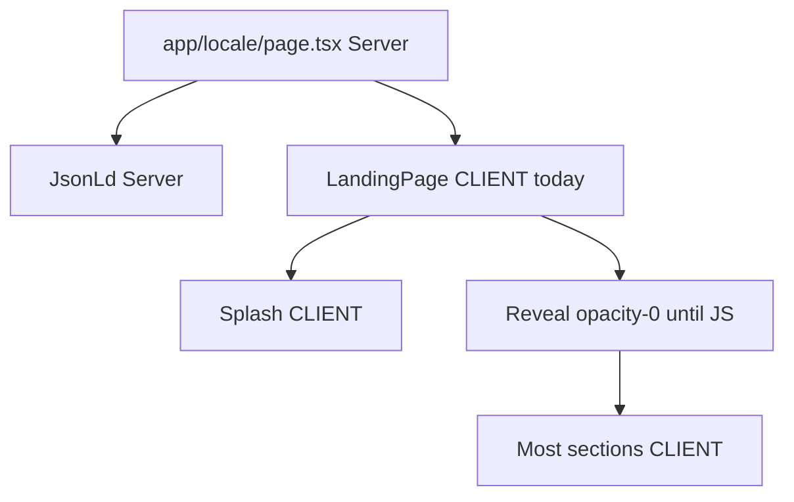

# Landing SSR for SEO

## Current reality (important)

In Next.js App Router, `"use client"` components **still SSR** (HTML is generated on the server, then hydrated). Your home page already has server `generateMetadata` + `JsonLd`.

The SEO risk is not “no SSR at all” — it is:

1. [`LandingPage.tsx`](src/features/landing/components/LandingPage.tsx) is a **client boundary**, so the whole tree ships as client JS and cannot use RSC benefits.
2. [`Reveal.tsx`](src/features/landing/components/Reveal.tsx) renders children with `opacity-0` until JS + IntersectionObserver run — text is in the DOM but treated as visually hidden.
3. [`HeroSection.tsx`](src/features/landing/components/HeroSection.tsx) also starts key copy at `opacity-0` until splash `ready`.



**Approach chosen:** Server Component shell + static RSC sections + client islands for motion/forms; SEO-safe visibility (content visible in initial HTML).

---

## Phase 1 — Server shell

1. Convert [`LandingPage.tsx`](src/features/landing/components/LandingPage.tsx) to a **Server Component** (remove `"use client"`).
2. Wrap only interactive pieces in a small client provider, e.g. `LandingClientChrome`:
   - `LandingMotionProvider`
   - `LandingSplash`
   - children (server-rendered sections passed as `children`)
3. Keep [`page.tsx`](src/app/[locale]/page.tsx) async server page (already correct).

---

## Phase 2 — Static sections → RSC

Convert sections that only need translations + markup (no hooks/framer) to Server Components using `getTranslations("landing")` from [`src/providers/i18n/server.ts`](src/providers/i18n/server.ts):

- [`PhilosophySection.tsx`](src/features/landing/components/PhilosophySection.tsx)
- [`CelebrateSection.tsx`](src/features/landing/components/CelebrateSection.tsx)
- [`AppPromoSection.tsx`](src/features/landing/components/AppPromoSection.tsx)
- [`LandingFooter.tsx`](src/features/landing/components/LandingFooter.tsx) (split out any tiny client bits if needed; links are fine on server)

**Stay client** (real interactivity / motion):

- `LandingNavbar`, `LandingSplash`, `LandingMotion`, `HeroSection`, `AboutSection`, `ServicesSection`, `ContactSection`, `Reveal`

---

## Phase 3 — SEO-safe visibility

1. **Reveal:** only apply `opacity-0` after mount:

```tsx
const [mounted, setMounted] = useState(false);
useEffect(() => setMounted(true), []);
// SSR + first paint: visible
// After mount: opacity-0 until in view, then animate
className={cn(mounted && !visible && "opacity-0", visible && "animate-...")}
```

2. **Hero:** ensure `<h1>` text is present and **not** `opacity-0` in SSR HTML (gate opacity animation behind `mounted`, same pattern). Brand image animation can stay.

3. **Services / About:** keep framer motion, but avoid SSR states that omit text from HTML (prefer `initial={false}` + animate after mount, which you largely already do).

---

## Phase 4 — Verify

1. `curl` production/local HTML and confirm presence of:
   - `<h1>` headline text
   - Philosophy / Services / About headings
   - JSON-LD script
2. Confirm View Source (not only DevTools Elements after hydration) contains that content.
3. Optional: Lighthouse SEO / “Disable JavaScript” smoke check that main copy remains readable.

---

## Out of scope

- Removing splash or all animations
- Changing metadata/sitemap (already done)
- Full rewrite of Contact form as RSC
